# Foreman

A self-hosted dashboard that takes a GitHub project through a spec-driven
SDLC with AI agents: interactive specification, then autonomous execution of
small, context-bounded subtasks on local (or cloud) models, with an
orchestrator that watches for runaway agents, replans after each task, and a
big red stop button.

Status: **M4 (multi-node & polish) implemented**: all planned milestones are
done (M1 sandboxed execution + stop controls, M2 specify & decompose, M3
autonomy, M4 multi-node scheduling, spend caps, egress lockdown, toolchain
images, portfolio view, Aider). Specs, plan and acceptance criteria live in
[`specs/000-orchestrator/`](specs/000-orchestrator/).

<p>
  <a href="#screenshots">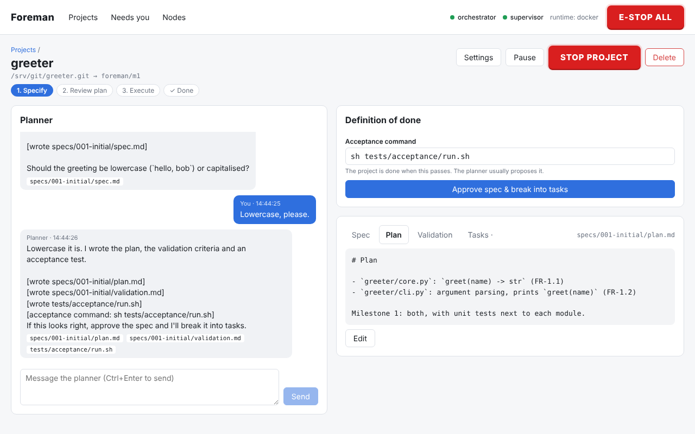</a>
  <a href="#screenshots">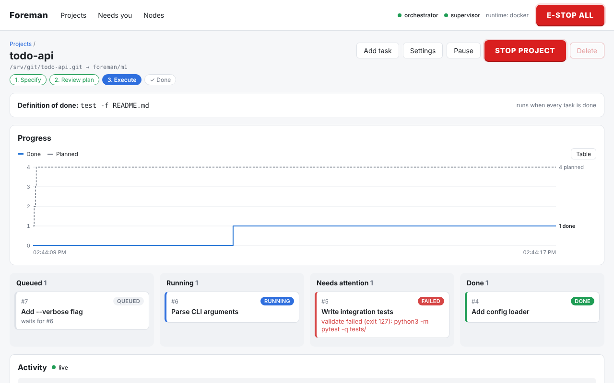</a>
</p>

*Left: writing the spec with the planner. Right: the agents working through the
tasks. More in [Screenshots](#screenshots).*

## How a project goes

1. **Specify.** Chat with a planner model (local, or Claude) about what you
   want to build. It drafts `spec.md` (requirements with ids like `FR-1.1`),
   `plan.md`, `validation.md` and executable acceptance tests, committing them
   to your repo under `specs/<feature>/`. You can edit any document directly.
2. **Approve the spec.** This checkpoint is always on. You also confirm the
   acceptance command, which defines "done" for the whole project.
3. **Breakdown.** The planner splits the plan into tasks. Each task gets a
   *context pack* (its slice of the requirements, the signatures of the files
   it depends on, the files it may change, and how it is validated) that is
   measured against the executor model's context window. Tasks that touch too
   many files or don't fit are sent back to the planner to split, up to three
   times.
4. **Review the plan** (optional checkpoint, on by default). Edit, drop or
   re-run tasks; tasks still too big block approval. `tasks.md` is committed
   alongside the spec.
5. **Execute, autonomously.** Tasks run one at a time per project in Docker
   containers built from `ubuntu:24.04`, using OpenCode (or Aider) as the
   coding agent. Each task's work is committed, checked against its allowed
   files and a diff-size limit, validated in the sandbox together with the
   project test command, and merged into the milestone branch.
   - **Sandbox.** Containers run as an unprivileged user on an internal
     Docker network whose only reachable endpoint is Foreman's model gateway:
     no internet, no LAN, no host (switch a project to "open" network if its
     tasks really need it). A project's `.foreman/Dockerfile` (written by the
     planner or by you, `FROM foreman/executor-base`) adds its language
     toolchain; Foreman builds it on demand and reuses it until it changes.
   - **Nodes.** Projects run side by side across your model servers. Each
     node has a capacity shared by task attempts and planner calls, and is
     health-checked every minute; work waits for a free slot on a healthy
     node.
   - **Watchdog.** Executors reach their model only through Foreman's *model
     gateway*, which counts calls and tokens against per-attempt budgets,
     stops an agent that keeps returning the same response, and adds the
     node's API key itself (keys never enter containers). Hitting a limit
     kills the attempt.
   - **Escalation.** A failed attempt is retried with a fresh agent session
     (told why the last one failed); if that keeps failing, or the same
     failure repeats, the planner splits the task into smaller ones; then it
     moves to an optional stronger *escalation* model; then it is blocked
     and lands in your inbox.
   - **Replanning.** After each task, a reviewer model checks the remaining
     plan against the goal and adds, removes or changes tasks, each with a
     reason. Revisions are recorded and `tasks.md` is updated. Growth beyond
     a cap (default +50% of the approved plan) waits for your approval, and
     spec changes always do.
6. **Done.** When every task is done, the acceptance command runs on a fresh
   checkout of the milestone branch. If it fails, the replanner gets the
   output and adds work. If it passes, the project is done, and after your
   approval the branch is pushed and a GitHub pull request is opened.

**Needs you.** Everything waiting for a decision (blocked tasks, plan
revisions over the cap, spec changes, optional merge approvals, the finished
milestone, a reached spend cap) collects in one inbox, with optional push notifications through
[ntfy](https://ntfy.sh). Which checkpoints are on is a per-project setting;
with only the always-on ones, a project runs from approved spec to pull
request by itself.

Throughout: a live dashboard (task board, streaming planner and agent output,
diffs, run history) and **Pause / Stop / E-stop** at task, project and global
level, enforced by a separate supervisor process that works even if the
orchestrator hangs. Stop also cancels an in-flight planner call. Stopped work
is preserved and can be retried or discarded.

**Spend caps.** Give cloud nodes a price per million tokens and projects a
spend cap. Every paid call (planner or executor) is charged to its project;
at the cap, paid calls stop and a budget checkpoint asks you to raise the cap
or pause the project. Local nodes are free and never count.

**Portfolio.** The projects page summarises every project (progress, active
task, open checkpoints, spend) and the node load; each project shows tasks
done against tasks planned over time, so replanning growth is visible.

**Restarts.** After a crash or restart nothing is left half-done: running
attempts are marked failed (and retried by the escalation ladder),
interrupted merges are aborted, stray processes and acceptance checks are
killed, and the main clone is reset to the milestone branch tip.

You can also skip the spec phase and add tasks by hand ("Skip the spec phase"
when adding a project).

## Screenshots

Captured from the running app (`scripts/screenshots.sh`). The planner here is
a scripted fake model and the tasks use the scripted `shell` executor to
imitate an agent, so the scenes are reproducible.

**Specify:** the planner drafts the documents with you; each turn's file
writes are committed to the repo.


**Review the plan:** tasks sized for the executor, with the requirements they
implement, their dependencies and how they'll be validated.

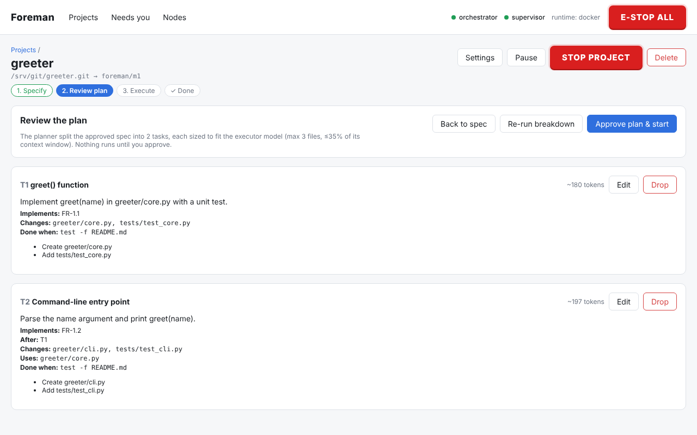

**Needs you:** decisions waiting for you, across all projects.

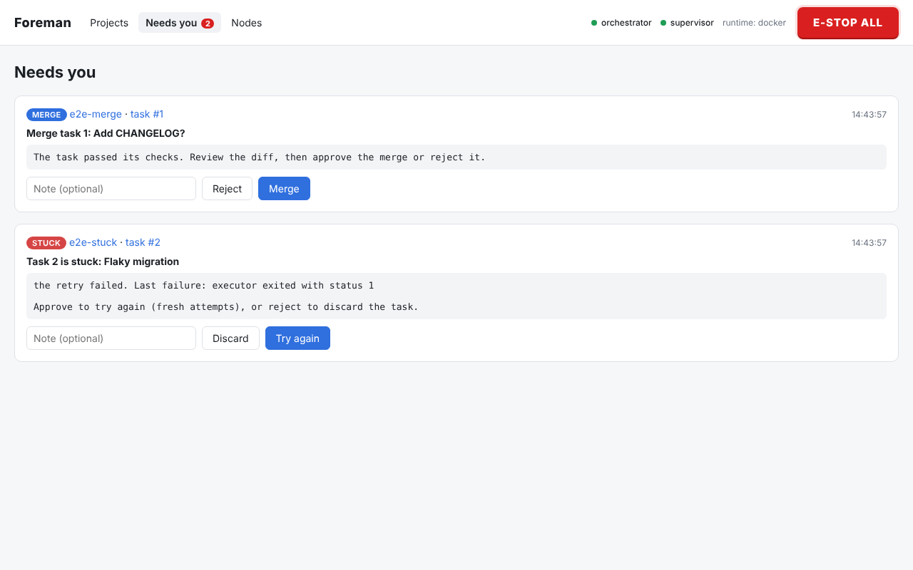

**Watchdog:** per-attempt budgets, escalation level and every step the
ladder took.

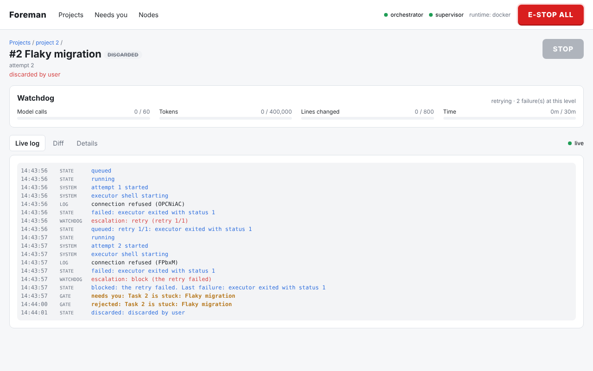

**Project board:** tasks flow from queued to done; dependencies and failure
reasons are shown on each card.


**Live log** of a running task, streamed from its container. This one is
stuck re-running the same failing test...

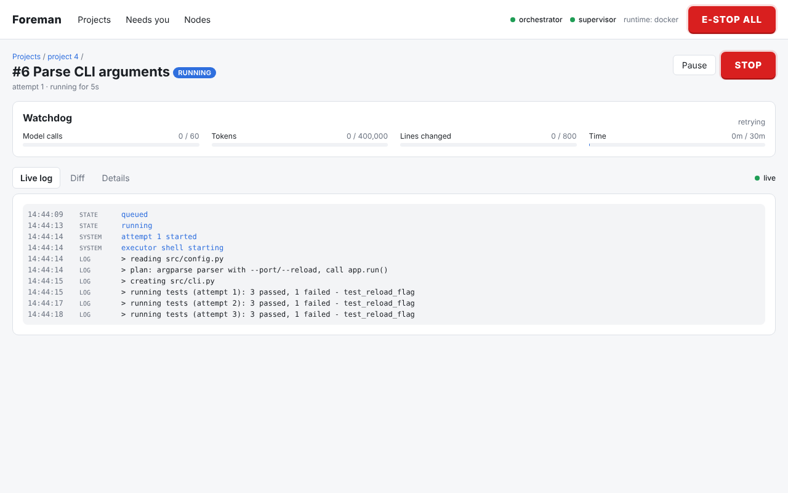

**...so it gets the big red button.** The agent is killed within seconds;
its partial work is kept and can be retried or discarded.

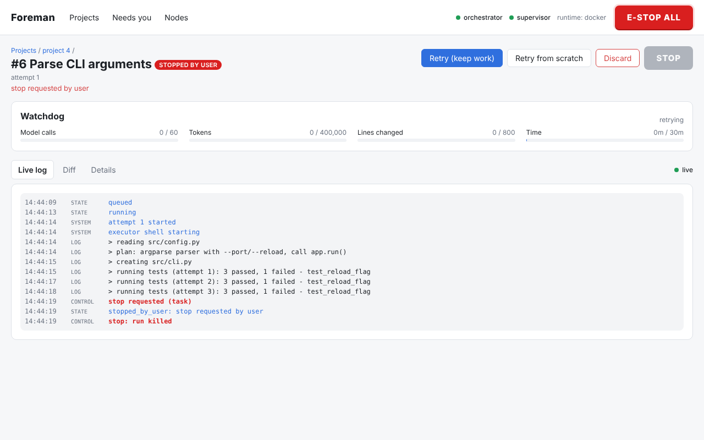

**Diff** of a finished task against the milestone branch.

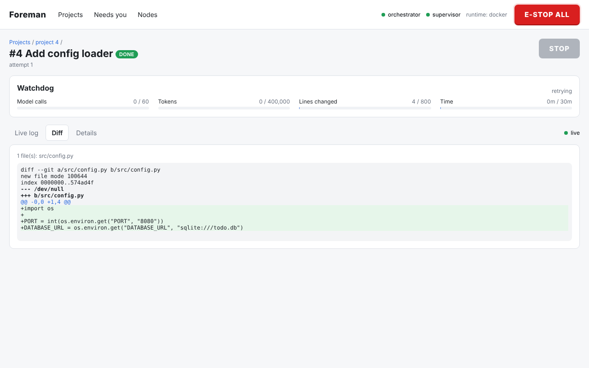

**E-STOP ALL** kills every running agent and blocks new work until cleared.

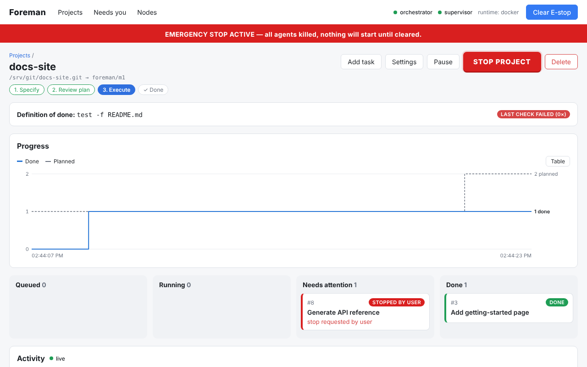

**Projects overview:** what's working, what needs you, node load and spend,
then each project's progress.

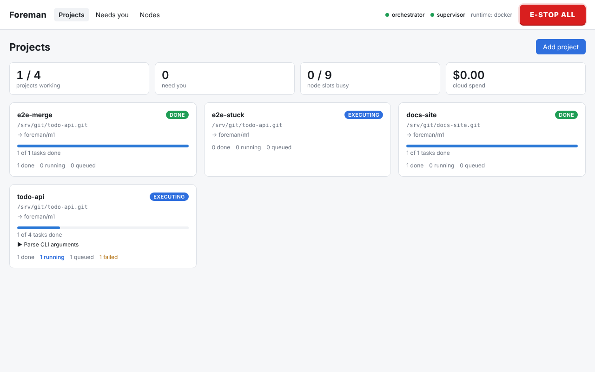

**Progress** of a project: tasks done against tasks planned (hover for
values, or switch to the table).

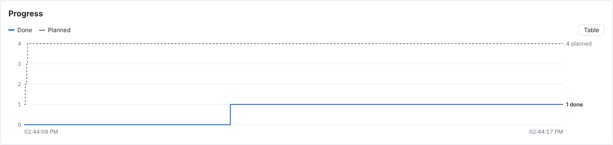

**Nodes:** local model servers and Claude side by side, with health, load,
what's waiting for them and, for paid ones, prices.

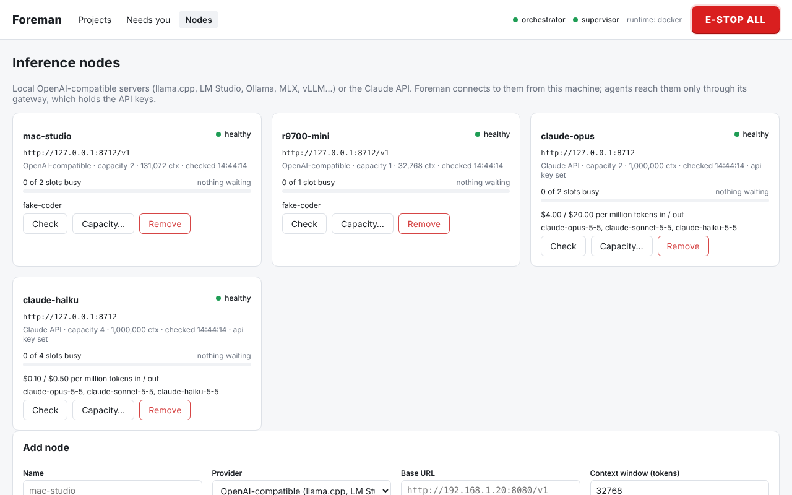

**Project settings:** which model plans, which one codes and which one takes
over when a task is stuck (local or Claude, per role), plus the sandbox
network, spend cap, watchdog limits, autonomy and checkpoints.

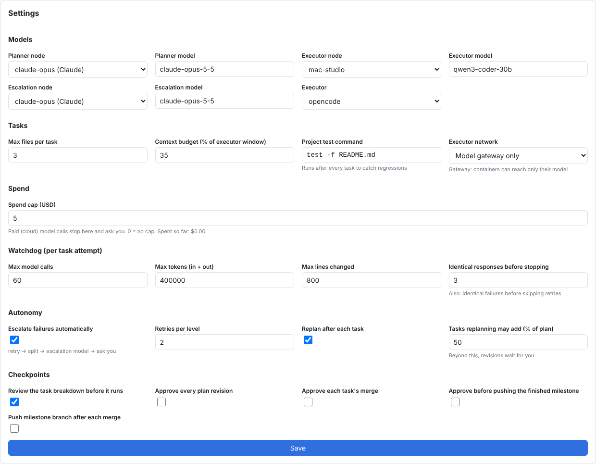

## Quick start

Requirements: Python 3.12+, [uv](https://docs.astral.sh/uv/), Node 20+, Docker, git.

```bash
uv sync                          # Python deps
(cd web && npm ci && npm run build)   # dashboard
uv run foreman build-image       # foreman/executor-base (ubuntu:24.04 + git + opencode)
                                 # add --with-aider to include Aider as well
uv run foreman up                # api + orchestrator + supervisor
```

Open http://127.0.0.1:8700 and add your model servers under **Nodes**:

- Local servers are "OpenAI-compatible", e.g. `http://192.168.1.20:8080/v1`
  for llama.cpp, or `http://127.0.0.1:1234/v1` for a server on the same
  machine (Foreman's gateway connects to it, not the container). Set the
  context window the model really has: task sizes are computed from it.
- Claude can be added with provider "Anthropic", base URL
  `https://api.anthropic.com` and your API key. Claude can fill any role: the
  planner calls it directly, and coding agents (OpenCode) reach it through
  Foreman's gateway, which adds the key on the host, so it never enters a
  sandbox. Enter its prices (USD per million input / output tokens) to track
  spend.
- **Capacity** is how many task attempts and planner calls a node serves at
  once; editable later on the Nodes page.

Then add a project, choose a planner and an executor (node + model), and
start talking to the planner.

### Trying it on Claude first

To see the whole loop before your local models are set up, run every role on
Claude: Opus plans and reviews, Sonnet takes escalations, Haiku writes the code.

```bash
export ANTHROPIC_API_KEY=sk-ant-...
uv run foreman claude-nodes                 # nodes claude-opus / -sonnet / -haiku, with prices
uv run foreman claude-nodes --project 3     # ...and assign them to project 3's roles
uv run python scripts/claude_smoke.py       # optional: a tiny project, idea to done, $3 cap
```

Give projects a spend cap (Settings → Spend) while you experiment. To move to
local models later, add your local nodes and switch each project's roles in
its Settings; nothing else changes.

### Configuration (environment variables)

| Variable | Default | Meaning |
|---|---|---|
| `FOREMAN_DATA_DIR` | `./data` | Databases, project clones, run logs |
| `FOREMAN_HOST` / `FOREMAN_PORT` | `127.0.0.1` / `8700` | API bind address |
| `FOREMAN_TOKEN` | *(empty)* | If set, required as `Authorization: Bearer …` |
| `FOREMAN_RUNTIME` | `docker` | `local` runs executors as host processes (tests/dev only, **no isolation**) |
| `FOREMAN_EXECUTOR_IMAGE` | `foreman/executor-base:latest` | Image for executor containers |
| `FOREMAN_CONTAINER_CPUS` / `_MEMORY` | `2` / `4g` | Per-container limits |
| `FOREMAN_STOP_GRACE_S` | `5` | SIGTERM → SIGKILL grace on Stop |
| `FOREMAN_GITHUB_TOKEN` | *(empty)* | Used by the orchestrator to clone/push and to open milestone pull requests; never passed to executors or written to `.git/config` |
| `FOREMAN_NTFY_URL` | *(empty)* | Push notifications for the inbox, e.g. `https://ntfy.sh/my-secret-topic` |
| `FOREMAN_PUBLIC_URL` | *(empty)* | Dashboard URL for links in notifications |
| `FOREMAN_GATEWAY_HOST` / `_PORT` | `0.0.0.0` / `8701` | Model gateway. Locked-down containers reach it through a relay container; every URL carries a per-run secret, but you can bind it to the Docker bridge (e.g. `172.17.0.1`) to keep it off the LAN |
| `FOREMAN_NODE_CHECK_S` | `60` | Seconds between node health checks (`0` disables them) |

## Architecture

Three OS processes share two SQLite databases:

- **api** (FastAPI): REST + Server-Sent Events + the React dashboard.
- **orchestrator**: schedules ready tasks and runs each attempt
  (clone → execute → commit → scope check → validate → merge), runs planner
  jobs (chat, breakdown, splits, plan reviews), acceptance checks, and the
  model gateway. It is also the only process that writes to the repositories:
  the API records your decisions on checkpoints and the orchestrator carries
  them out.
- **supervisor**: executes Stop/E-stop. It kills containers/process groups
  first, then records the outcome.

`foreman.db` holds projects, tasks, runs and events. `control.db` holds stop
requests and the E-stop flag and is never written by the orchestrator, so a
hung orchestrator holding a write lock cannot block a Stop.

Each task works in its own standalone clone (`data/projects/<id>/tasks/<task>`),
mounted at `/workspace` in the container. The rendered prompt and tool config
are mounted read-only at `/foreman`. Nothing else from the host is visible.
Containers join `foreman-net-<instance>`, an internal Docker network; the
`foreman-relay-<instance>` container on it forwards `foreman-gateway:8701` to
the gateway on the host and is the only way out.

## Development

```bash
uv run pytest -q                 # unit, integration, multi-process stop tests;
                                 # Docker tests run when the image is present
uv run ruff check src tests && uv run mypy src
(cd web && npm run dev)          # dashboard with hot reload, proxies /api to :8700
scripts/e2e.sh                   # full stack + Playwright browser tests
scripts/screenshots.sh           # regenerate docs/screenshots/
python -m tests.fakellm 8999 --demo  # scripted planner + coding model for demos
                                 # (speaks both the OpenAI chat and Claude Messages APIs)
```
